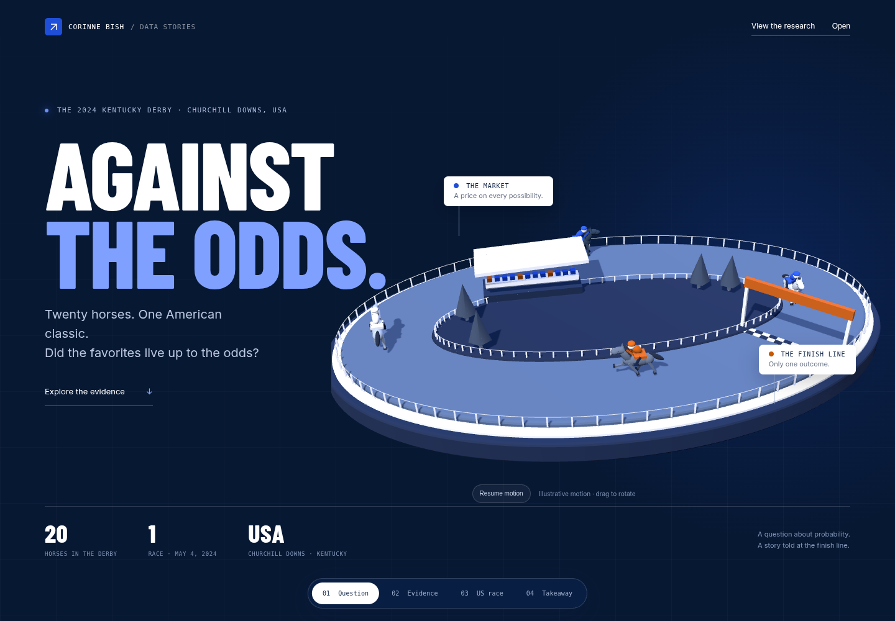

# Against the odds · The 2024 Kentucky Derby

An interactive USA-only portfolio story by Corinne Bish, written for people who do not follow horse racing.

The entire project covers the **2024 Kentucky Derby at Churchill Downs, Louisville, Kentucky, USA**, on May 4, 2024. It contains all 20 starters from one real American race.



## Explore

- An original 3D racetrack with galloping horses and a finish line spanning the racing surface from the inner rail to the outer rail. Drag to rotate or pause the motion; reduced-motion settings and a non-WebGL fallback are supported.
- Plain-English examples explain odds, adjusted chances, favorites and longshots.
- Linked charts compare rank by final odds with official finish, and show each horse’s adjusted chance of winning. Filter to all horses, the five lowest-odds horses, or longshots; sort by odds or finish.
- Choose any horse to inspect its odds and finish. A historical bet-size illustration shows the known return and net profit/loss.
- Scrub a replay through six published race checkpoints, or follow any of the 20 horses. Movement between checkpoints is illustrative, not measured speed or distance gaps.
- Download precisely the horse records selected in the charts.

## What happened

Mystik Dan won at **18.61-to-1**, seventh in the ranking by odds, and returned **$39.22 on a $2 win bet**. Favorite Fierceness finished **15th**. These are descriptive facts about one race: they do not establish market bias, a reliable win rate, or a repeatable betting advantage.

US odds-to-one describe profit. Adding one includes the original stake. Raw chance is `1 / (odds + 1)`; adjusted chance divides each horse’s raw chance by the total across all 20 horses. Filtering never renormalizes a subset into a different race.

## Free source

[Equibase official result chart: Churchill Downs, May 4, 2024, race 12](https://irp.cdn-website.com/c33a1b13/files/uploaded/Results_2024_Kentucky_Derby.pdf). Twenty factual runner records, final odds and checkpoint ranks were transcribed into `data/examples/kentucky_derby_2024.csv`. © 2024 Equibase Company LLC. Public viewing does not imply a general redistribution license. Provenance and an input SHA-256 fingerprint are included in the snapshot.

All race observations in the project are from the USA. Horse names may carry breeding-country suffixes; these do not indicate another race venue. This is an independent historical portfolio project, not a live betting or prediction service. No paid feed or API key is required.

## Run and rebuild

```bash
pip install -r requirements.txt
streamlit run app.py
```

All libraries, fonts and data are bundled locally. To rebuild and check the evidence:

```bash
python analysis.py
pip install pytest
python -m pytest -q
```

Static preview: `python -m http.server 8765 --directory docs`. Optional browser checks are in `tests/browser_checks.py` and require Playwright and Chromium.

`analysis.py` builds the source-backed browser snapshot and processed CSV. `docs/` contains the page, charts, original 3D scene, local fonts and libraries. `app.py` hosts the same page in Streamlit. Library/font attribution is in [THIRD_PARTY.md](THIRD_PARTY.md).

## Deployment

The Google Cloud Run address requires a repository Actions secret named `GCP_SA_KEY`. Once configured, pushes to `main` or **Actions → Redeploy to Cloud Run → Run workflow** verify the app and deploy it. The last deployment attempt was blocked because that secret was missing; a repository update alone does not update the live service.
